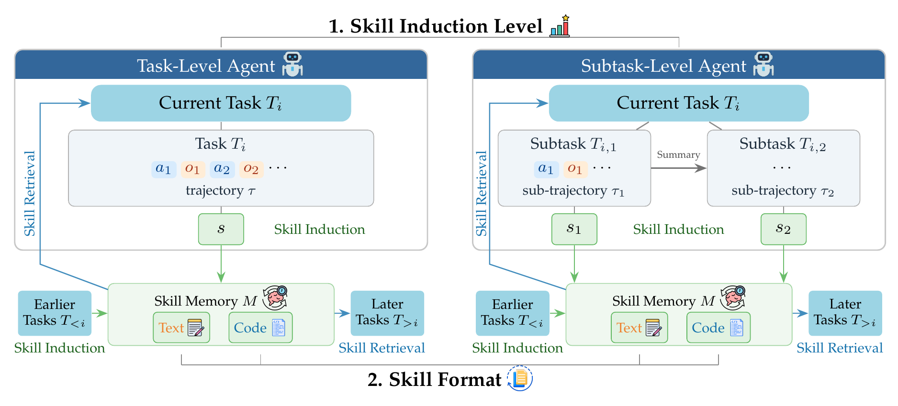

# Break It Down, Pass It On: Cross-Task Skill Transfer in LLM Agents

We have released the official code and data for the paper [*"Break It Down, Pass It On: Cross-Task Skill Transfer in LLM Agents"*](https://arxiv.org/abs/2608.20274).

Large language model (LLM) agents can induce skills from completed tasks and reuse them later to grow more capable with experience. In practice those skills transfer unreliably, and can even harm the agent that retrieves them. We study when they transfer reliably, comparing the two axes along which existing methods differ: task-level versus subtask-level skill induction, and text versus code skill formats, across three long-horizon benchmarks and eleven models.



Skills mostly help when they are induced at the subtask level, while task-level induction often makes the same memory harmful, and text skills help more than code skills at both levels. What makes a skill useful is a combination of two things: it has to be specific enough to match real tasks, and abstract enough to stay relevant across many of them. Neither dimension predicts task success on its own, so we combine them into a skill utility score. Computed directly from the induced skills, it predicts task success and matches the reuse we observe.

## Layout

### Code

```
skill_induction/            the experiment package
  agents/                   task-level (linear*) and subtask-level (subtask*) agents
  analysis/                 skill utility scoring and the high/low library split
  envs/                     AppWorld / OfficeBench / KramaBench adapters
  memory/                   text (awm) and code (asi) skill memories + retrieval
  models/                   Bedrock, Vertex Gemini, and local-vLLM chat clients
  prompts/                  every prompt: ReAct cores, role blocks, induction prompts
  caching/                  disk-backed LLM cache and per-task call ledger
  experiments/run.py        the experiment CLI
  paths.py                  all configurable paths (env-var overridable)
scripts/
  exp.sh                    run agents x models x benchmarks on the current node
  submit.sh                 one sbatch job per (model x benchmark)
  build_inspector.py        regenerate the trajectory viewer from the pickles
  unsolved_skill_ratio.py   share of skills induced from unsolved source tasks
  gemma3_pythonic.jinja     vLLM chat template for Gemma-3 tool calling
api_key/                    credentials (fill in the template; never commit real keys)
figures/                    notebook output directory
assets/                     images used by this README
```

### Data

`data/results/` is not tracked in git. Download the archive from the link in `data/RESULTS_DOWNLOAD.txt` and extract it inside `data/` before running the notebook or the viewer.

```
data/
  final_paper_plot.ipynb                       reproduces every notebook-generated paper asset
  inspector.html                               trajectory viewer shell
  RESULTS_DOWNLOAD.txt                         download link and checksum for the results archive
  results/                                     635 pickles + 3 json, 16 GB, downloaded separately
    <bench>_<agent>_<model>_<stage>.pkl        one run per experiment cell: per-task records with
                                               task metadata, outcome, full message history,
                                               per-call LLM ledger, and skills induced/retrieved
    <bench>_<agent>_<model>_<stage>_memory.pkl the skill library that cell induced (+ provenance log)
    shuffle_order_<bench>_seed0.json           task-stream order shared by all conditions
    _embcache_final_v1.pkl                     cached sentence embeddings for the utility analysis
    _judge_relevance_v1.pkl                    LLM-judge relevance labels
    _oracle_selfretr_final_v1.pkl              self-retrieval rows
    inspector_tasks/                           one HTML fragment per task, loaded by the viewer

  <bench>   appworld | officebench | kramabench
  <agent>   linear | linear_awm | linear_asi | subtask | subtask_awm | subtask_asi
            linear = task-level, subtask = subtask-level; awm = text skills, asi = code skills
  <stage>   final_v1             main experiments
            noprune_v1           subtask_asi rerun without runtime error pruning; the paper's
                                 main table reads Subtask+Code from this stage
            prompt_abl2_L1/L2    induction-prompt ablation (L3 is final_v1)
            subskill_v1          task-level agent replaying the subtask-level frozen library
            utilnt_*_v1          high/low utility-half replays on KramaBench; the small
                                 *_utilsplit.pkl companions record each arm's split
```

The analysis notebook scores every subtask condition under the shared 50-step budget, counting runs that exceed it as failures.

## Setup

### Python Environments

```
conda create -y -n llm-agent-env python=3.11 && conda activate llm-agent-env
pip install numpy scipy pandas openpyxl tqdm filelock requests boto3 google-genai sentence-transformers matplotlib

conda create -y -n appworld-env python=3.11 && conda activate appworld-env
pip install appworld==0.1.3.post1

conda create -y -n officebench-env python=3.10 && conda activate officebench-env
pip install pandas openpyxl python-docx PyPDF2 pdf2docx icalendar pytesseract scikit-learn tabulate

conda create -y -n vllm python=3.12 && conda activate vllm     # only for the *-local models
pip install vllm
```

All experiments, `scripts/*`, and the notebook work in `llm-agent-env`. The other three environments are launched by the scripts (`appworld-env` and `vllm` as subprocesses, `officebench-env`'s python inside the container), so you don't need to manually activate the other three environments. You should keep these names or override them with `ENV_NAME`, `VLLM_ENV`, and `OFFICEBENCH_CONTAINER_PYTHON`.

### API Keys

Copy the template and fill in your own keys:

```
cp api_key/config.example.json api_key/config.json
```

- `bedrock_api_key` / `bedrock_region` for the Bedrock-served MoE models (or standard AWS credentials via the environment).
- `gcp_project` / `gcp_location` for Gemini on Vertex AI (auth via `gcloud auth application-default login`).
- `huggingface_api_key` for downloading gated model weights for vLLM.

### Benchmarks

The benchmark environments live outside the repo under `SKILL_INDUCTION_EXTERNAL` (default `external/`); see `skill_induction/paths.py` for every path and its env override:

- **AppWorld**: place its data under `external/appworld-data/` (`APPWORLD_DATA_ROOT`); the server itself runs in the `appworld-env` conda env created above.
- **OfficeBench**: vendor the upstream benchmark under `external/_port/officebench/` (`OFFICEBENCH_PORT_ROOT`) and build an apptainer image with LibreOffice + Tesseract at `external/officebench-sandbox/officebench.sif` (`OFFICEBENCH_SANDBOX_SIF`). Set `OFFICEBENCH_CONTAINER_PYTHON` if `officebench-env` is not at `~/miniconda3/envs/officebench-env/bin/python3`.
- **KramaBench**: vendor the upstream repo (task workloads + data lakes) under `external/_port/kramabench/` (`KRAMABENCH_PORT_ROOT`). Its kernel is a local subprocess that reuses the runtime env's interpreter (`KRAMABENCH_PYTHON` to override).

## Experiments

### A Single Cell

```
python -m skill_induction.experiments.run \
    --agent subtask_asi --benchmark appworld \
    --model qwen-3-235b-a22b-amazon --stage final_v1 --max-iter 50
```

Results append to `data/results/` and runs resume from the result pickle.

Useful flags: `--num-tasks/-N`, `--override` (ignore the resume checkpoint), `--induction-level {1,2,3}` (induction-prompt ablation ladder), `--shuffle-seed` (fixed task-stream order), `--skills-level {task,subtask}` + `--skills-stage` (frozen-library replay arm; `--subtask-skills` is the legacy alias of `--skills-level subtask`), `--skills-half {high,low}` (median-utility split of the donor library; see `skill_induction/analysis/skill_utility.py`), `--skills-no-threshold` (pure top-k retrieval for the halves comparison).

### Whole Matrices

On the current node, starting and reusing a local vLLM automatically for `*-local` models:

```
AGENTS="subtask_awm subtask_asi" MODELS="qwen-3-32b-local" BENCHES="appworld" bash scripts/exp.sh
```

On Slurm, one job per model x benchmark. Fill in `YOUR_ACCOUNT` / `YOUR_PARTITION` at the top of `scripts/submit.sh` (or pass `ACCOUNT=... PART=...` as env vars), then:

```
MODELS="qwen-3-32b-local" BENCHES="appworld officebench kramabench" bash scripts/submit.sh
```

## Analysis

### Paper Figures

Open `data/final_paper_plot.ipynb` and run it top to bottom from `data/`. It reads the pickles from `data/results/`, prints the Table 2 (`tab:main`) numbers first, then writes each figure PDF in the paper's order of appearance to `figures/`. Only `numpy` + `matplotlib` are required; the skill-utility cells reuse `data/results/_embcache_final_v1.pkl`, so no GPU or embedding model is needed. The difficulty figure additionally needs the AppWorld task metadata (`APPWORLD_TASKS_DIR`, default `external/appworld-data/data/tasks`).

### Trajectory Viewer

Open `data/inspector.html` directly in a browser (works over `file://`; per-task content loads lazily into an iframe), or serve it:

```
python -m http.server -d data
# then visit http://localhost:8000/inspector.html
```

Filter by benchmark, agent, model, stage, or outcome and click a task to see its full dialogue, subtask plans and summaries, and the skills it retrieved and induced. `scripts/build_inspector.py` regenerates the viewer from the pickles.

### Skill Provenance

How many induced skills came from a task the agent did not solve, split by induction level and skill format:

```
python scripts/unsolved_skill_ratio.py
```

## License

Code and released artifacts are under the MIT License (see `LICENSE`).

## Citation

If you find our work useful, please cite the paper:

```
@misc{feng2026breakdownpasson,
      title={Break It Down, Pass It On: Cross-Task Skill Transfer in LLM Agents}, 
      author={Yiyang Feng and Biddut Sarker Bijoy and Niranjan Balasubramanian and Jiawei Zhou},
      year={2026},
      eprint={2608.20274},
      archivePrefix={arXiv},
      primaryClass={cs.AI},
      url={https://arxiv.org/abs/2608.20274}, 
}
```
